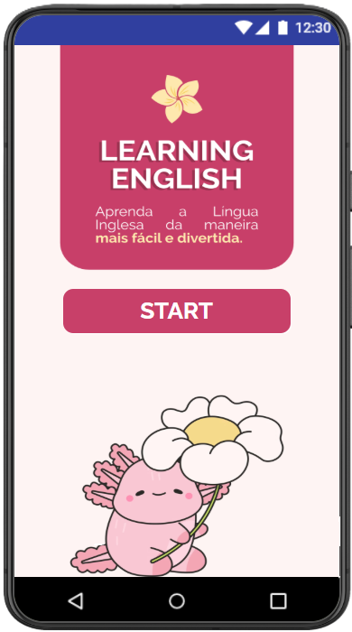
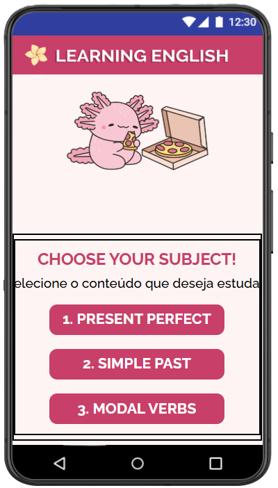
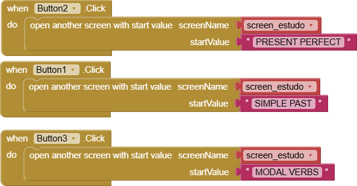
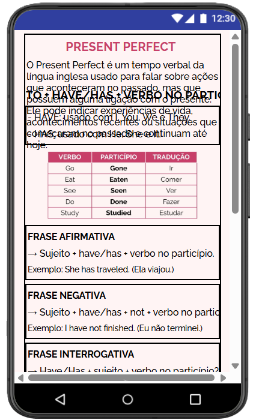
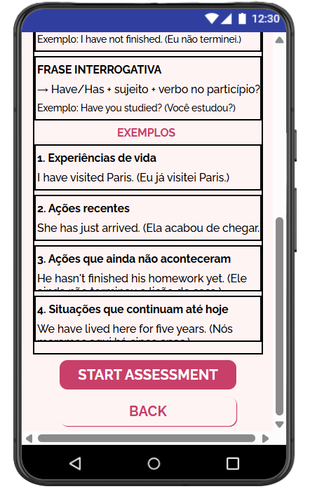
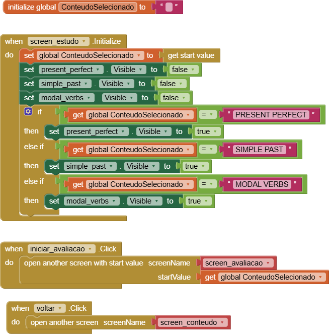
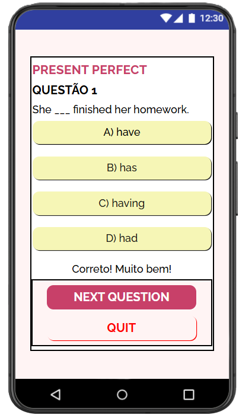
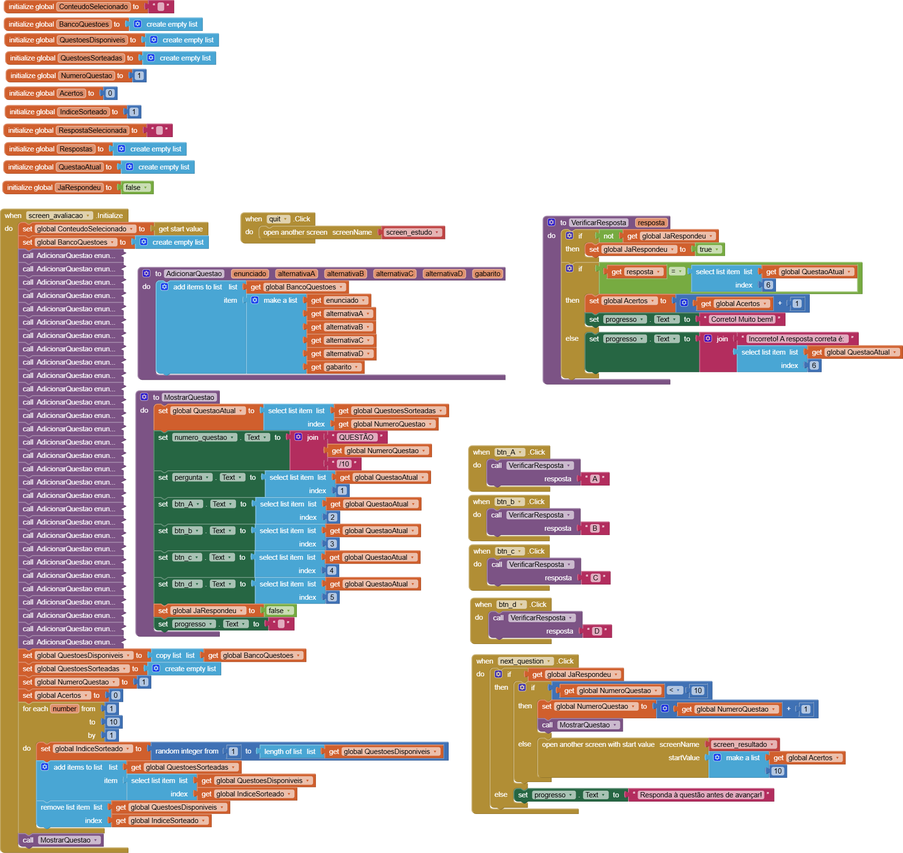
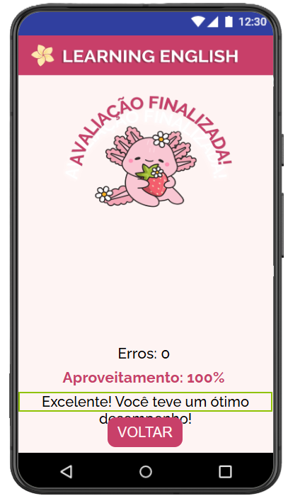
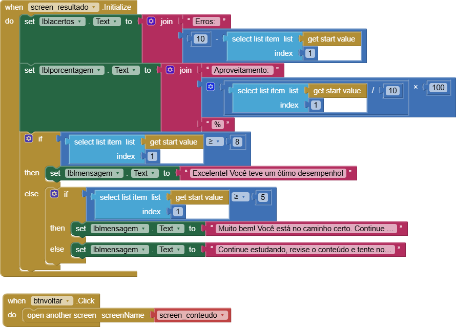

# Relatório dos Aplicativo com Avaliação e Material de Estudos de Inglês

**`Instituição:`**
ETEC Vasco Antônio Venchiarutti

**`Curso:`**
Informática para Internet

**`Turma:`**
2º ano D

**`Autores:`**
- [Amanda Neves Oliveira](https://github.com/amandanevoli)
- [Ana Lívia Takeyama Romanato](https://github.com/liviatakeyama)

---

# Aplicativo - Learning English

## Descrição

***Objetivo:***   

O objetivo do aplicativo é auxiliar os estudantes no aprendizado da língua inglesa, oferecendo um ambiente interativo e de fácil utilização para estudar conteúdos gramaticais e testar os conhecimentos adquiridos. A proposta é tornar o estudo mais dinâmico, permitindo que o usuário revise os assuntos e pratique por meio de questões de múltipla escolha.

***Funcionamento:***   

Ao iniciar o aplicativo, o usuário terá acesso a uma tela inicial e poderá selecionar o conteúdo que deseja estudar. Atualmente, estão disponíveis três assuntos: Present Perfect, Simple Past e Modal Verbs.

Após escolher um conteúdo, o aplicativo apresenta uma tela com explicações e exemplos sobre o tema selecionado. Ao finalizar os estudos, o usuário poderá iniciar uma avaliação para verificar seu aprendizado.

A avaliação é composta por 10 questões de múltipla escolha, selecionadas aleatoriamente de um banco com 30 perguntas relacionadas ao conteúdo escolhido. Cada questão apresenta quatro alternativas, identificadas pelas letras A, B, C e D, sendo apenas uma delas correta. O usuário deve selecionar uma alternativa para receber o feedback e, em seguida, avançar para a próxima questão. Não é permitido avançar sem responder à questão atual.

Ao concluir as 10 perguntas, o aplicativo apresenta uma tela de resultados com a quantidade de acertos, erros, porcentagem de aproveitamento e uma mensagem de desempenho. Dessa forma, o estudante consegue acompanhar seu resultado e identificar a necessidade de revisar o conteúdo.

| Print da tela do Design | Print da tela dos Blocos |
|------|------|
|  |  |
|   |  |
|    |  |
|   |  |
|   |  |